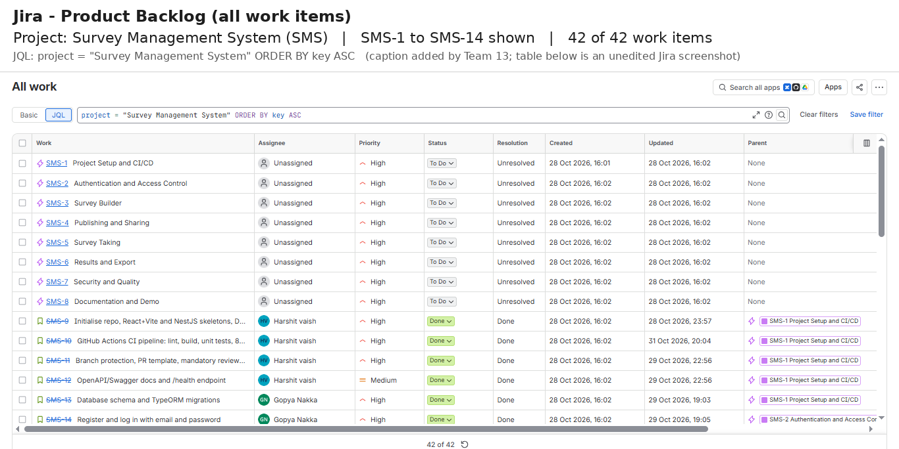
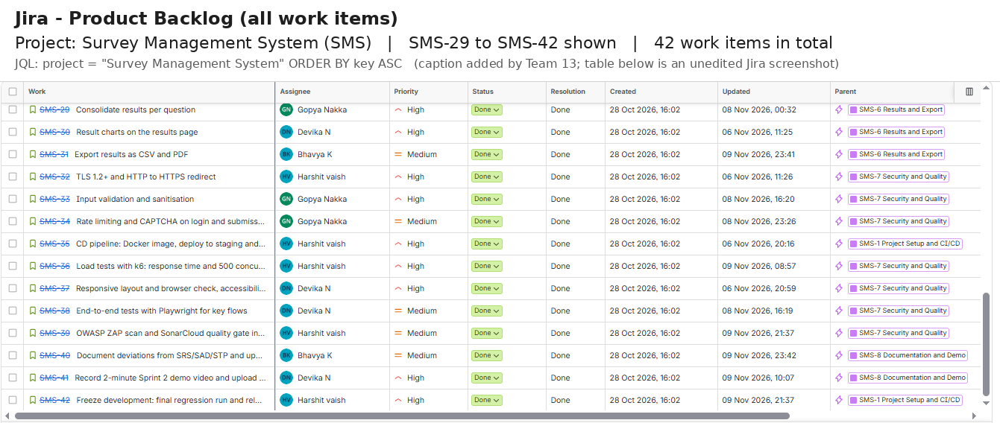
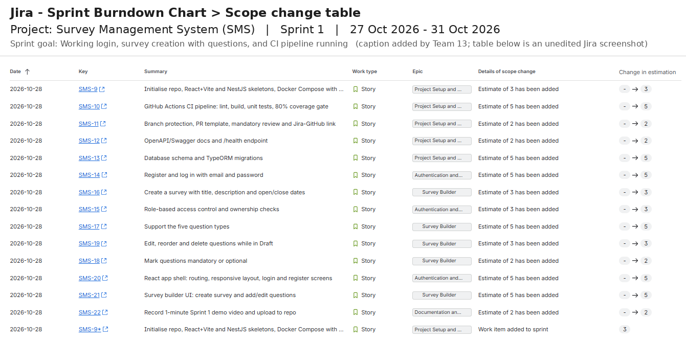
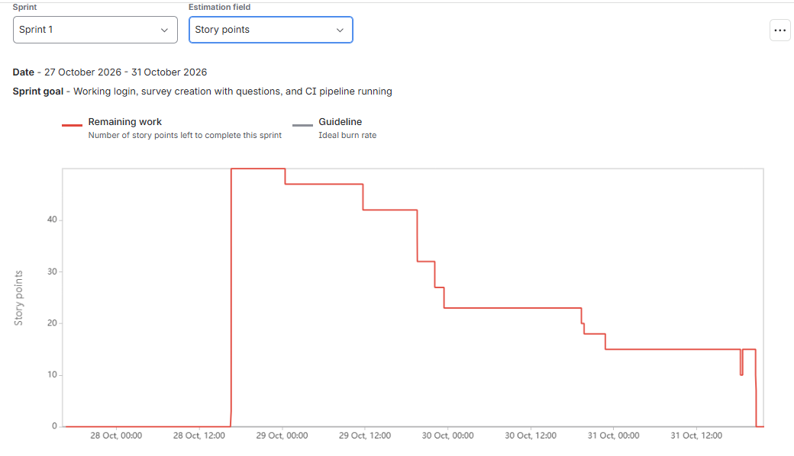

# Survey Management System (SMS)

A web application for creating surveys, sharing them by link or QR code, collecting responses (anonymously), and analysing the results with charts and CSV/PDF exports.

**Team 13** · Agile (Scrum) · Version 1.1 · November 2026

| Name | Branch / Section |
|---|---|
| Harshit Vaish | AIML – B Section |
| Nakka Gopya | AIML – B Section |
| Devika N | AIML – B Section |
| Bhavya K | AIML – B Section |

---

## Features

| SRS ID | Feature |
|---|---|
| SVY-F-001 | Register and log in with email and password |
| SVY-F-002 | Role-based access (Creator, Respondent, Administrator) |
| SVY-F-003 | Password reset by emailed link (single use, expires after 30 minutes) |
| SVY-F-004 | Create surveys with title, description and optional open/close dates |
| SVY-F-005 | Question types: single choice, multiple choice, text, rating scale, dropdown |
| SVY-F-006 | Mark questions as required or optional |
| SVY-F-007 | Edit, reorder and delete questions while the survey is a draft |
| SVY-F-008 | Lifecycle Draft → Published → Closed; structure locked after publishing; auto-close on close date |
| SVY-F-009 | Unique share link (random slug) and QR code for each published survey |
| SVY-F-010 | Submission validation: required questions must be answered |
| SVY-F-011 | Duplicate-submission prevention for single-response surveys |
| SVY-F-012 | Anonymous responses: no user ID or email stored with a response |
| SVY-F-013 | Results per question: counts, percentages and rating averages |
| SVY-F-014 | Charts on the results page |
| SVY-F-015 | Export results as CSV or PDF (owner only) |

**Security (SVY-SR-001 to SR-005):** TLS 1.2+ via Nginx with HTTP→HTTPS redirect, Argon2id password hashing, ownership checks on every endpoint, input validation and sanitisation against SQL injection and XSS, per-IP rate limiting and optional hCaptcha on login and survey submission, HttpOnly session cookie, Helmet security headers.

## Tech stack

| Layer | Technology |
|---|---|
| Frontend | React 19, TypeScript, Vite, React Router, Chart.js |
| Backend | NestJS (Node.js), TypeScript, TypeORM, class-validator, Swagger |
| Database | PostgreSQL 16 |
| Email | Nodemailer (SMTP); Mailpit for local testing |
| Testing | Vitest, React Testing Library, Playwright (end-to-end) |
| DevOps | Docker, Nginx, GitHub Actions (CI/CD), OWASP ZAP, SonarCloud |

Architecture: layered three-tier modular monolith (React SPA → REST/JSON API → PostgreSQL). See the SAD for details.

## Repository layout

```
backend/            NestJS REST API (auth, surveys, responses, results, security, health)
frontend/           React single-page app and Playwright end-to-end tests (frontend/e2e)
nginx/              Nginx reverse proxy config for HTTPS (certs go in nginx/certs)
scripts/            Smoke test, dev-certificate generator, TLS check (TC-Sec-01)
.github/workflows/  CI, CD and E2E pipelines
.zap/               OWASP ZAP scan rules
jira-screenshots/   Jira evidence: dashboard, backlogs, sprint progress, burndown charts
docker-compose.yml        PostgreSQL + Mailpit for local development
docker-compose.https.yml  Nginx HTTPS proxy for local TLS testing
```

## Running locally

**Prerequisites:** Node.js 22, npm, Docker.

1. **Start the database and test mail server**

   ```bash
   docker compose up -d
   ```

   PostgreSQL runs on port 5432. Mailpit catches emails on SMTP port 1025; open http://localhost:8025 to read them (for example the password-reset email).

2. **Start the backend API** (port 3000)

   ```bash
   cd backend
   npm install
   npm run build
   npm run start:dev
   ```

   Database migrations run automatically on start-up. The defaults match `docker-compose.yml`, so no configuration is needed for local use. To change settings, set the environment variables listed in [`.env.example`](.env.example). API documentation (Swagger) is at http://localhost:3000/api/docs.

3. **Start the frontend** (port 5173)

   ```bash
   cd frontend
   npm install
   npm run dev
   ```

   Open http://localhost:5173 and create an account.

### Configuration

All settings are environment variables; see [`.env.example`](.env.example). The most important:

| Variable | Purpose |
|---|---|
| `DB_HOST`, `DB_PORT`, `DB_USER`, `DB_PASSWORD`, `DB_NAME` | PostgreSQL connection |
| `JWT_SECRET` | Session signing key (required in production) |
| `FRONTEND_ORIGIN` | Allowed CORS origin |
| `PUBLIC_BASE_URL` | Base URL used in share links and QR codes |
| `SMTP_HOST`, `SMTP_PORT` | Mail server for password-reset emails |
| `SURVEY_TIMEZONE` | Time zone for survey open/close dates |
| `RATE_LIMIT_ENABLED`, `RATE_LIMIT_*` | Rate-limit switches and limits |
| `HCAPTCHA_SECRET`, `VITE_HCAPTCHA_SITE_KEY` | hCaptcha keys (leave empty to turn CAPTCHA off) |

### HTTPS (local TLS testing)

```powershell
./scripts/gen-certs.ps1                       # self-signed certificate for localhost
docker compose -f docker-compose.https.yml up -d
./scripts/tc-sec-01.ps1                       # checks HTTP→HTTPS redirect and TLS 1.2+ only
```

## Testing

```bash
# Backend unit and integration tests with coverage (fails below 80 %)
cd backend && npx vitest run --coverage

# Frontend unit tests with coverage
cd frontend && npx vitest run --coverage

# End-to-end tests (database and API must be running)
cd frontend && npx playwright install && npm run e2e
```

| Suite | Result |
|---|---|
| Backend | 298 passed, 6 skipped · ~86 % line coverage |
| Frontend | 110 passed · ~83 % line coverage |
| End-to-end | Register/login, build and publish, respond, access control, results (Chromium, Firefox, WebKit, mobile) |

## CI/CD

- **CI** (`.github/workflows/ci.yml`), on every push and pull request: lint, build, unit tests with coverage, migrations on an empty database, schema-drift check, database tests, OWASP ZAP API and frontend scans, SonarCloud quality gate.
- **CD** (`.github/workflows/cd.yml`), after CI passes on `main`: builds and pushes backend and frontend Docker images to GitHub Container Registry, deploys to staging, runs a smoke test, then deploys to production.
- **E2E** (`.github/workflows/e2e.yml`): Playwright tests against the deployed environment.

## Project management (Jira)

Work was planned and tracked in Jira (project **Survey Management System, key SMS**) using Scrum. All screenshots are stored in the [`jira-screenshots/`](jira-screenshots/) folder.

### Sprint summary

| Sprint | Dates | Sprint goal | Scope |
|---|---|---|---|
| Sprint 1 | 27 Oct 2026 – 31 Oct 2026 | Working login, survey creation with questions, and CI pipeline running | 14 stories (SMS-9 to SMS-22), 50 story points |
| Sprint 2 | 2 Nov 2026 – 10 Nov 2026 | Working end-to-end survey flow (create, share, respond, view results) deployed through CI/CD | 68 story points (SMS-23 onwards, up to SMS-42) |

### Screenshots

| File | What it shows | Status |
|---|---|---|
| `01-jira-dashboard.png` | Team 13 dashboard: created vs resolved chart, issues by assignee, and filter results for all SMS issues | Done |
| `02a-product-backlog.png`, `02b-product-backlog.png` | Product backlog: all epics and stories (SMS-1 to SMS-42) before sprint planning | Still to take |
| `03-sprint1-backlog.png` | Sprint 1 backlog: stories committed with their story points | Done |
| `03-sprint2-backlog.png` | Sprint 2 backlog: stories committed with their story points and assignees | Done |
| `04-sprint1-progress.png` | Sprint 1 progress: board and status of work at the end of the sprint | Done |
| `04-sprint2-progress.png` | Sprint 2 progress: board and status of work at the end of the sprint | Done |
| `05-burndown-sprint1.png` | Sprint 1 burndown chart (remaining story points vs guideline) | Done |
| `05-burndown-sprint2.png` | Sprint 2 burndown chart (remaining story points vs guideline) | Done |

### Previews

**Jira dashboard**


**Product backlog**




**Sprint 1**





**Sprint 2**


### Notes on the burndown charts

- **Sprint 1:** the sprint started on 27 Oct, but the 50 story points were added to the sprint on 28 Oct, so the remaining-work line starts at 50 on that day and then burns down to 0 by 31 Oct.
- **Sprint 2:** the sprint started with 68 story points and burned down to 0 by 10 Nov.

## Project documents and media

| File | Description |
|---|---|
| `TEAM13_SRS_Survey_Management.docx` | Software Requirements Specification (functional, non-functional and security requirements, RTM) |
| `SAD_TEAM13_SURVEY MANAGEMENT.docx` | Software Architecture and Design Specification |
| `TEAM13_Test_Plan_Survey_Management.docx` | Software Test Plan (test cases and acceptance criteria) |
| `SMS-40_Deviation_Report_and_Updated_RTM.docx` | Implementation deviations and updated traceability matrix |
| `Sprint1_demo_video.mp4`, `Sprint2_demo_video.mp4` | Sprint demo videos |
| `jira-screenshots/` | Jira dashboard, backlogs, sprint progress and burndown charts |

## Known limitations

- **Performance and scalability (SVY-NF-001, NF-002):** load tests for the 2-second response time and 500 concurrent users have not been run yet.
- **Availability (SVY-NF-003):** no uptime monitoring report yet; it needs a running production deployment.
- **Accessibility and browser checks (SVY-NF-004):** the end-to-end tests run on Chromium, Firefox, WebKit and a 360 px mobile viewport, but there is no automated WCAG audit.
- **Anonymous responses (SVY-F-012):** all responses are stored anonymously by default, instead of anonymity being an option the creator switches on.
- **Administrator:** the role has full access through the API, but there is no admin user-management screen; admin accounts are created directly in the database.
- **Frontend coverage:** about 83 % of lines, but branch and function coverage are below 80 % and the frontend build does not enforce a threshold.
